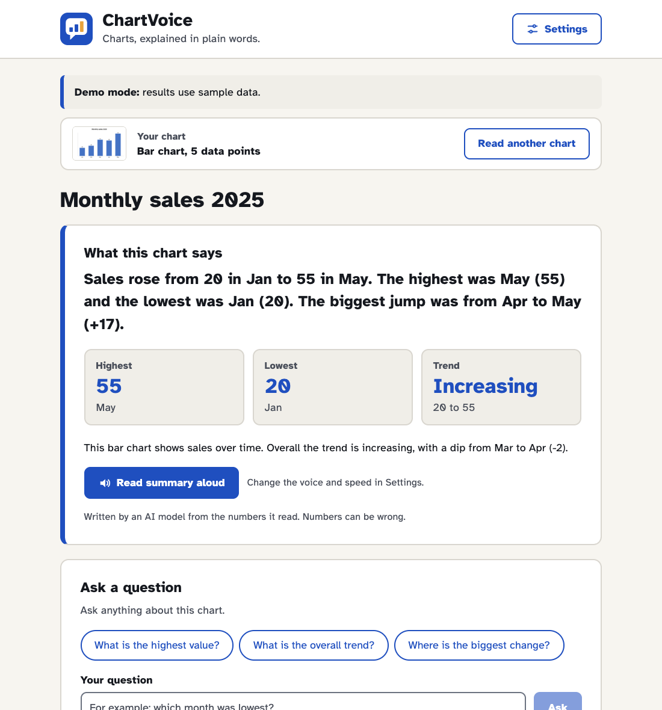
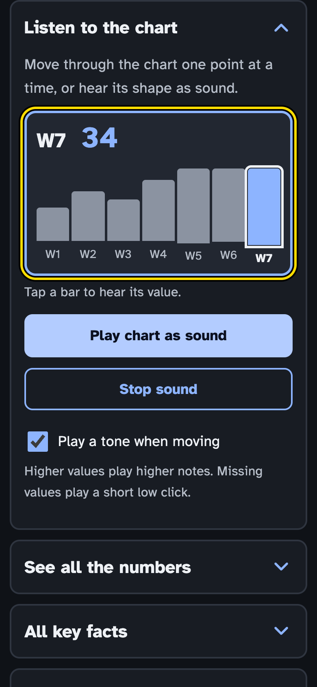
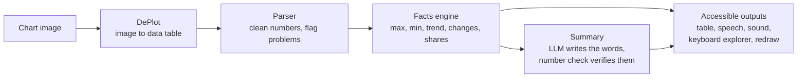

<p align="center">
  
</p>

# ChartVoice

**Hear, read and check the numbers inside a chart.**

ChartVoice turns a picture of a bar, line or pie chart into a plain-language summary, a real data table, speech and sound. It is built for people who can't see a chart, struggle to read one, or just don't trust their reading of it.

Built in one weekend at [Banana Hacks 2026](https://www.bananahacks.tech) by Inam, Hasnain and Talal.

<p align="center">
  
</p>

## Why we built this

Charts are everywhere: textbooks, news, research papers, company reports. They often hold the one number that matters most, and they are almost always just an image.

If you use a screen reader, that image usually comes out as "image", or as alt text like "a bar chart showing sales". The data is right there, and you can't get to it. If you have low vision, the labels are tiny and the lines are thin. And plenty of people with perfect eyesight look at a chart and quietly hope someone else will tell them what it means.

We wanted a tool where you drop in a chart and get the numbers back in a form you can actually use: read to you, laid out in a table, played as sound, and open to questions.

## What it does

- **Reads the chart image.** An image AI model pulls out the underlying data table.
- **Tells you what matters, in plain words.** The highest and lowest values, the overall trend and the biggest change, worked out in code from the extracted numbers rather than guessed by a language model.
- **Reads it aloud.** It picks the best voice your device has, rewrites the text so it sounds natural ("Jan (20)" is spoken as "January, 20"), and highlights each sentence as it goes so you can follow along.
- **Lets you listen to the shape of the chart.** Higher values play higher notes. Arrow keys move point by point, and each point is announced, for example "Mar, 40. Up 15 from Feb. Point 3 of 5."
- **Shows the real table.** A proper HTML table a screen reader can move through cell by cell, with a CSV download.
- **Answers questions.** "Which month was lowest?" Questions that aren't about the chart get a polite no.
- **Lets someone check its work.** Your original image sits next to a chart redrawn from the extracted numbers. If they don't match, something was misread, and a sighted helper can spot it in seconds.
- **Warns you when something looks off.** For example, when pie slices don't add up to about 100%, or some values couldn't be read.

<p align="center">
  
</p>

## How it works



1. **Image to table.** [DePlot](https://huggingface.co/google/deplot), a pretrained model from Google, reads the chart image and writes out its data table. This is the heart of the project. Without it there are no numbers.
2. **Table to facts.** Our own code cleans the table and computes the facts: highest, lowest, first and last, trend, biggest rise and drop, and shares for pie charts. These are plain arithmetic, so they are never "hallucinated".
3. **Facts to words.** A language model on Groq turns the facts into a friendly summary. Every number it writes is checked against the table and the facts. If it invents one, we throw the text away and fall back to a simple template summary.
4. **Words to something you can use.** The frontend turns all of this into speech, sound, a navigable table, a keyboard explorer and a redrawn chart.

### Why not just ask a chatbot?

You can paste a chart into a general AI chatbot and get a paragraph back. The problem is that it sometimes gets numbers wrong, and if you can't see the chart, you have no way to catch it.

| | General AI description | ChartVoice |
|---|---|---|
| What you get | A paragraph | Summary, table, speech, sound, keyboard explorer, redrawn chart |
| Where the numbers come from | Written by the language model | Read from the image, then computed in code |
| Can someone check it? | Not easily | Yes, the original and the redrawn chart side by side |
| Tells you when it might be wrong | Rarely | Built-in warnings |

ChartVoice has a "Compare with a generic AI" button that shows both answers for the same image, so you can judge for yourself.

## Accessibility

This was the part we cared about most, so we tried to get the details right:

- Works with just a keyboard, and was built and tested with screen readers in mind: real headings, live announcements, focus that moves to the results when they're ready, and a skip link.
- Three color themes (light, dark and high contrast), plus Windows forced-colors support.
- Three text sizes. The layout reflows instead of breaking, even at the largest size on a small phone.
- Uses [Atkinson Hyperlegible](https://www.brailleinstitute.org/freefont/), a typeface the Braille Institute designed for low-vision readers.
- Meaning never relies on color alone. Values are printed on the redrawn chart, and the selected point has an outline.
- Every button is at least 44 px tall, so it's easy to tap.
- An automated check (axe-core, WCAG 2.2 AA) runs in every theme, on desktop and phone widths.

Automated checks only catch part of the problems. If you use a screen reader and try ChartVoice, we would really like to hear what was annoying.

## Try it

### Frontend only (demo mode, no backend needed)

```bash
cd frontend
npm install
npm run dev
```

Open http://localhost:5173 and pick one of the sample charts. In demo mode (`VITE_USE_MOCK=true` in `frontend/.env`) the results come from built-in sample data, so you can explore the whole interface without the model.

### With the real backend

The backend is a FastAPI app on http://localhost:8000. It loads DePlot and calls Groq, so it needs a `GROQ_API_KEY` in `backend/.env` (see `backend/.env.example`). Then set `VITE_USE_MOCK=false` in `frontend/.env` and restart `npm run dev`. Vite forwards `/api` requests to the backend.

DePlot is about 1 GB and runs on a normal laptop CPU. The first chart after startup is slower while the model loads, and the app tells you when that's happening.

### Accessibility check

```bash
cd frontend
npx playwright install chromium   # first time only
npm run build && npm run preview  # terminal 1
npm run test:a11y                 # terminal 2
```

## Project layout

```
Chart-Voice/
├── backend/     FastAPI app: DePlot extraction, parsing, facts, checks, Groq LLM module
├── frontend/    React + TypeScript app (details in frontend/README.md)
└── eval/        Evaluation on a set of charts with known data
```

## Evaluation

We are measuring ChartVoice on 30 bar, line and pie charts whose true data we know:

- **Value accuracy:** the share of extracted values within 5% of the real value.
- **Summary correctness:** whether the highest value, lowest value and trend are right.
- **Baseline:** a general AI model describing the same charts, scored the same way.
- **Speed:** median seconds per chart on a laptop CPU.

Results and a few honest failure cases will go here once the runs are done.

## Limitations

We'd rather you hear these from us:

- **Values are approximate.** When a chart has no data labels, DePlot estimates values from bar heights and line positions. That's why the redrawn chart and the warnings exist.
- **Only bar, line and pie charts.** Stacked bars, dual axes, scatter plots and maps are out of scope for now.
- **Your image leaves your device.** Summaries, questions and the comparison use Groq's hosted models, so don't upload anything confidential.
- **The keyboard explorer needs a keyboard.** Screen reader users on a phone can still get everything from the summary, the table and read aloud, but the explorer needs a touch-friendly version.
- **Read aloud uses your device's voices.** Quality depends on your browser and system. Edge has natural-sounding online voices. On a Mac, you can download a better voice under System Settings, Accessibility, Spoken Content.

## Things we learned the hard way

- Chrome stops speaking long text partway through. Reading one sentence at a time fixed it, and that also made the sentence highlighting possible.
- macOS ships novelty voices like "Bad News" and "Bubbles", and they show up in the browser's voice list next to the real ones. ChartVoice now filters them out and picks the most natural voice it can find.
- Our first results page showed everything at once: seven cards, a two-column grid and a row of jump links. Looking at it as an ordinary user, it was simply too much. Now you see the summary and a question box, and everything else is one tap away.

## What's next

- **Fix a wrong value** in the table and have the summary, sound and redrawn chart update straight away.
- A **touch-friendly explorer** for screen reader users on phones.
- **More chart types**, and charts inside PDFs.
- A **browser extension** that reads any chart on any web page.

## Team

| | Worked on |
|---|---|
| **Inam** ([@inamjadoon](https://github.com/inamjadoon)) | Backend API, DePlot extraction and parsing, facts and checks, evaluation |
| **Hasnain** | Groq LLM module (summaries, questions, comparison, number check), sample charts and ground truth |
| **Talal** | Frontend: interface, accessibility, read aloud, sonification and keyboard explorer |

## Credits

ChartVoice stands on a lot of other people's work:

- [DePlot](https://huggingface.co/google/deplot) (`google/deplot`) by Google, Apache-2.0
- Language and vision models served by [Groq](https://groq.com)
- [FastAPI](https://fastapi.tiangolo.com), MIT
- [React](https://react.dev), [Vite](https://vite.dev) and [TypeScript](https://www.typescriptlang.org), MIT and Apache-2.0
- [Chart.js](https://www.chartjs.org), MIT
- [Atkinson Hyperlegible](https://www.brailleinstitute.org/freefont/) by the Braille Institute, SIL Open Font License, via [Fontsource](https://fontsource.org)
- [axe-core](https://github.com/dequelabs/axe-core) (MPL-2.0) and [Playwright](https://playwright.dev) (Apache-2.0) for accessibility testing
- Browser Web Speech API and Web Audio API for speech and sound

### AI tools used during the build

As the hackathon rules ask, here is every AI tool we used:

- **DePlot** and **Groq-hosted models** are part of the product, as described above.
- **Claude Code** (Anthropic) was used as a coding assistant on the frontend.
